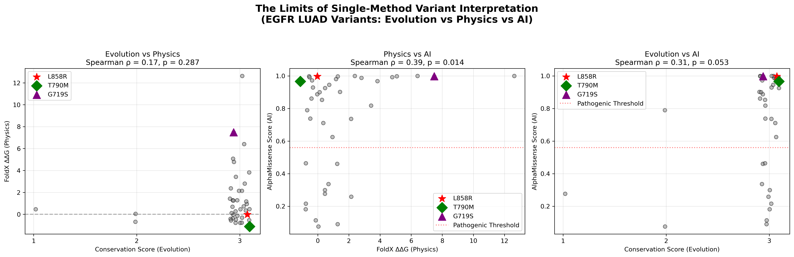

# Benchmarking AI Variant Predictors Against Physics and Evolution

**An evaluation of AlphaMissense (AI) against FoldX (thermodynamics) and cross-species conservation (evolution) for 40 LUAD EGFR variants.**

---

## Motivation

AI-based variant effect predictors like AlphaMissense are revolutionizing genomics. However, these models are "black boxes." When AlphaMissense predicts that a variant is pathogenic, is it actually learning the physics of protein stability? Or is it just memorizing evolutionary patterns (i.e., "this position is conserved, therefore any mutation is bad")?

This project benchmarks AlphaMissense against two orthogonal biological layers generated in previous projects: **FoldX ΔΔG (Physics)** and **Conservation (Evolution)**. 

---

## The Grand Portfolio Summary

This repository is Project 5 of a 5-part EGFR portfolio. The figure below is the visual abstract of the entire portfolio. It demonstrates that no single computational method (Evolution, Physics, or AI) perfectly predicts the others.



### What the Figure Tells Us

1. **Evolution vs. Physics (Left):** Spearman ρ = 0.17. Evolutionary constraint and thermodynamic stability are almost entirely orthogonal. A residue can be conserved for functional reasons without being structurally fragile.
2. **Physics vs. AI (Center):** Spearman ρ = 0.39. AlphaMissense has learned *some* physics (it tends to flag structurally destabilizing mutations), but the correlation is weak enough to prove it is not just running a physics calculation.
3. **Evolution vs. AI (Right):** Spearman ρ = 0.31. The AI also leans on evolutionary patterns, but again, imperfectly.

### Highlighting the Outliers

*   **L858R (Red Star):** Structurally neutral (ΔΔG = -0.02) but AlphaMissense correctly flags it as pathogenic because it recognizes the evolutionary importance of the DFG motif.
*   **G719S (Purple Triangle):** Highly destabilizing (ΔΔG = +7.48) but the AI score is lower than L858R, showing that the AI prioritizes evolutionary/frequency data over pure thermodynamics.

**Conclusion:** AI variant predictors are powerful triage tools, but they are mixed heuristics, not perfect biophysical simulators. Clinical interpretation requires integrating AI with physics (FoldX) and evolution (Conservation).

---

## Project Connection

This portfolio studies the EGFR/ErbB family from five distinct angles:

| Project | Focus | Key Finding |
|---------|-------|-------------|
| **1. Allosteric Discovery** | Structure & Drug Design | Found an allosteric pocket and validated docking via MD and AD4. |
| **2. ErbB Phylogenomics** | Evolution | Proved the pocket is 450 Mya old and kinase is under purifying selection. |
| **3. LUAD Survival** | Clinical Outcome | L858R effect reverses depending on the TKI treatment era (p=0.0003). |
| **4. Structural Analysis** | Physics | Conservation and FoldX stability are orthogonal (ρ=0.17). |
| **5. AI Benchmark** | AI/ML | AlphaMissense correlates weakly with both physics and evolution. |

---

## Repository Structure

```text
egfr-ai-variant-benchmark/
├── README.md
├── data/
│   ├── alphamissense_egfr.tsv           # Raw AI scores from DeepMind
│   └── merged_ai_physics_evolution.tsv  # Final merged dataset
├── figures/
│   ├── portfolio_summary_figure.png     # The 3-panel master figure
│   ├── ai_vs_physics.png                # Individual scatter
│   └── ai_vs_evolution.png              # Individual scatter
└── scripts/
    ├── 01_fetch_alphamissense.py        # API attempt (kept for record)
    ├── 03_merge_and_plot.py             # Merge FoldX + Cons + AI
    └── 04_portfolio_summary_plot.py     # Generates the 3-panel figure
## Author

## Preet Beniwal — Independent bioinformatics portfolio project.
GitHub: @preet-beniwal

## License
MIT — see LICENSE.
